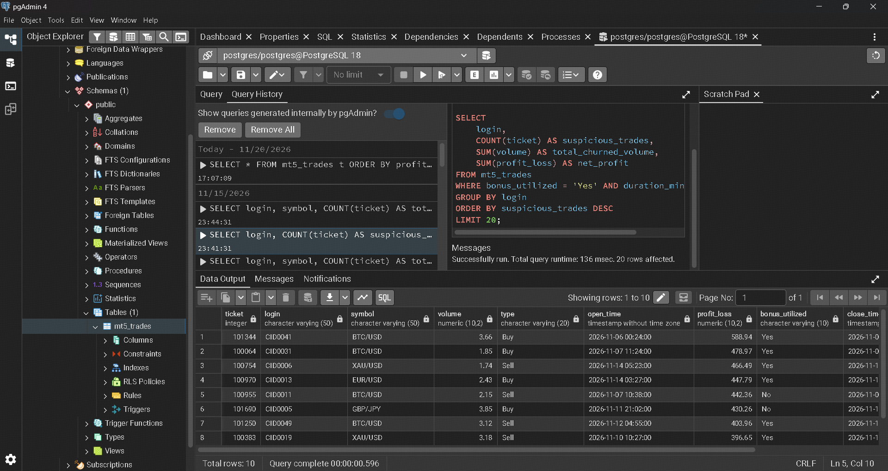
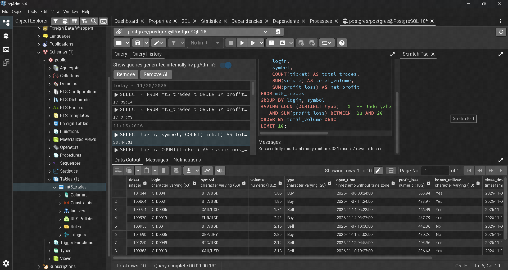
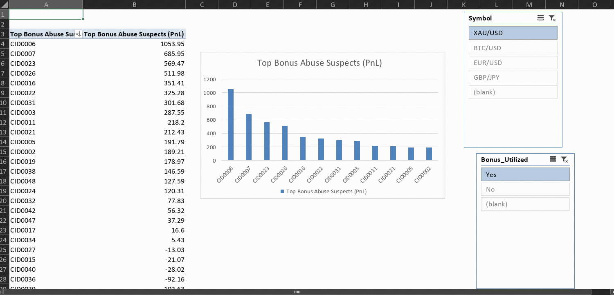
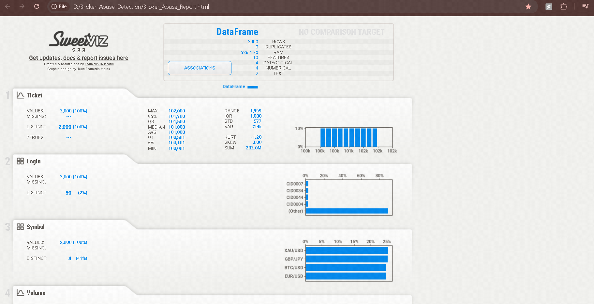

# Broker Abuse & Fraud Detection Engine (MT5 Risk Analytics)

An end-to-end FinTech Risk & Fraud Analytics pipeline built with **Python, PostgreSQL, and Excel** to simulate MetaTrader 5 (MT5) retail trading logs, detect **IB Churning / Bonus Abuse** and **Wash Trading**, and visualize high-risk accounts in an interactive dashboard.

---

## Business Problem
Retail Forex and CFD brokerages face significant financial exposure when Introducing Brokers (IBs) or clients exploit trading infrastructure through toxic order flow, credit bonus arbitrage, and artificial volume generation. Manual log review is slow and error-prone. This project automates anomaly flagging using SQL rules and surfaces top suspects for rapid compliance triage.

---

## Project Architecture & Tech Stack
* **Data Generation & EDA (`Python`):** Generated a synthetic dataset of **2,000 MT5 trades** across **50 client accounts** (`XAU/USD`, `EUR/USD`, `GBP/JPY`, `BTC/USD`) using `pandas` and `numpy`, injecting a **15% IB Churning anomaly** (trades closing in 30–120 seconds with near-zero PnL). Automated data profiling was performed using `sweetviz`.
* **Fraud Detection Engine (`PostgreSQL / pgAdmin 4`):** Loaded trade logs into the `mt5_trades` table and engineered SQL detection queries (`fraud_logic.sql`) to isolate high-risk accounts.
* **Risk Dashboard (`Excel / OnlyOffice`):** Cleaned suspect exports (`TRIM`, `Paste as Values`), built dynamic suspect lookup tools (`XLOOKUP`, `FILTER`), and created an interactive Pivot Dashboard with `Symbol` and `Bonus_Utilized` slicers.

---

## Fraud Scenarios Flagged

### 1. Bonus Abuse & IB Churning
Flags accounts utilizing credit bonuses that execute hyper-active trades closing in **under 2 minutes** to harvest IB rebates or exploit bonus terms.

### 2. Wash Trading / Hedging
Uses `GROUP BY` and `HAVING COUNT(DISTINCT type) = 2` to catch accounts executing opposing `Buy` and `Sell` positions on the same symbol with **near-zero net PnL (`-$20` to `+$20`)** to artificially inflate trading volume.

---

## Visualizations & Reporting

### Interactive Broker Abuse Dashboard
Tracks **Top Bonus Abuse Suspects by PnL** with dynamic filtering by `Symbol` (`XAU/USD`, `BTC/USD`, `EUR/USD`, `GBP/JPY`) and `Bonus_Utilized` status.

### Automated Data X-Ray (Sweetviz EDA)
Full statistical distribution of trade tickets, client logins, symbols, volumes, and profit/loss anomalies.

---

## Repository Structure
* `data_gen.py` — Python script to generate synthetic MT5 trade logs and the Sweetviz HTML report.
* `mt5_mock_data.csv` — Raw synthetic dataset (2,000 trades, 50 clients).
* `fraud_logic.sql` — PostgreSQL queries for Bonus Abuse and Wash Trading detection.
* `wash_trading_suspects.csv` — Exported high-risk suspect list from PostgreSQL.
* `mt5_mock_data.xlsx` — Interactive Risk Dashboard with Pivot Tables, Slicers, and `XLOOKUP`/`FILTER` views.
* `Broker_Abuse_Report.html` — Interactive Sweetviz EDA report.
